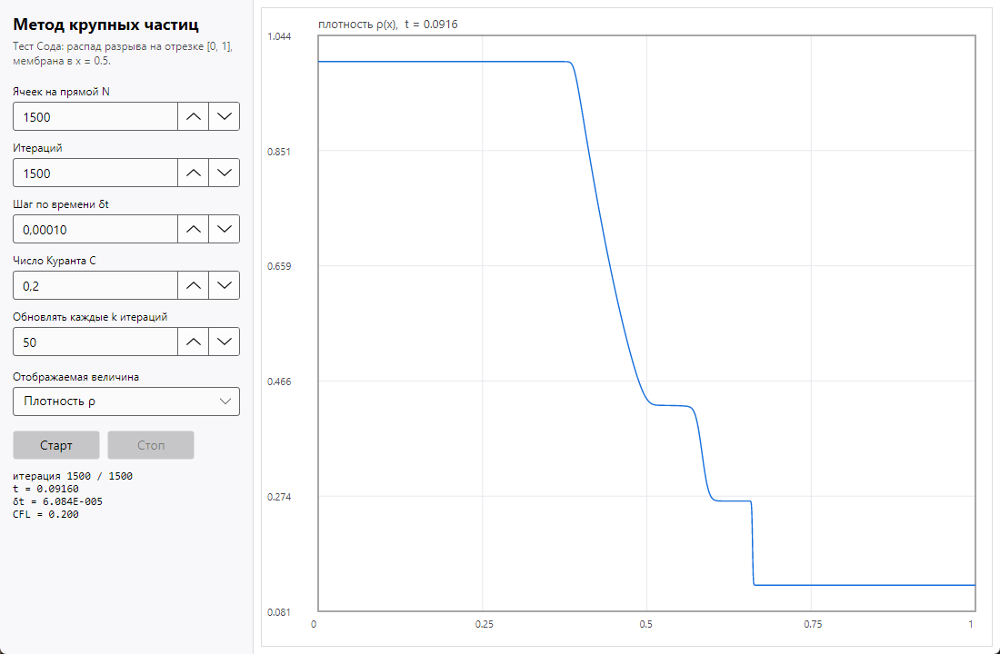

# Тест Сода — метод крупных частиц (1D)

Программа численно решает одномерную задачу газовой динамики о распаде разрыва
(тест Сода) методом крупных частиц (Белоцерковский–Давыдов) и показывает
результат в графическом окне (Avalonia UI).

## 1. Постановка задачи

Область `x ∈ [0, 1]`, в точке `x_m = 0.5` — мембрана, разделяющая покоящийся газ
с разными параметрами (γ = 1.4):

| область | ρ | u | p |
|---|---|---|---|
| `x < 0.5` | 1.0 | 0 | 1.0 |
| `x > 0.5` | 0.125 | 0 | 0.1 |

Уравнения Эйлера в консервативной форме:

```
∂ρ/∂t  + ∂(ρu)/∂x        = 0
∂(ρu)/∂t + ∂(ρu² + p)/∂x = 0
∂(ρE)/∂t + ∂((ρE + p)u)/∂x = 0,     E = p/((γ-1)ρ) + u²/2
```

Граничные условия — «нулевой градиент» (значение в фиктивной ячейке берётся из
соседней расчётной), то есть границы свободно пропускают возмущения.

В результате распада разрыва образуются: веер разрежения, контактный разрыв,
ударная волна. Точное решение при γ = 1.4:

| величина | значение |
|---|---|
| скорость за ударной волной | u* = 0.92745 |
| давление | p* = 0.30313 |
| ρ между веером и контактным разрывом | 0.42632 |
| ρ между контактным разрывом и ударной волной | 0.26557 |
| скорость ударной волны | D = 1.75215 |

## 2. Численная схема (метод крупных частиц)

Обозначения: `ρ, u, p` — плотность, скорость, давление; `m = ρu`, `E` — полная
энергия единицы объёма; `μ = Δt/Δx`. Потоки на гранях строятся по донорской
(наветренной) ячейке, скорость на грани — полусумма скоростей соседних ячеек:

```
u_{i+1/2} = (u_i + u_{i+1}) / 2,     f_{i+1/2} = u_{i+1/2} · f(донор)
```

**1-й этап — эйлеров (перенос без учёта давления).** Работают только силы инерции:

```
ρ'_i = ρ_i - μ (F_{i+1/2} - F_{i-1/2}),   F = u_{i+1/2} ρ_{донор}
m'_i = m_i - μ (M_{i+1/2} - M_{i-1/2}),   M = u_{i+1/2} m_{донор}
E'_i = E_i - μ (N_{i+1/2} - N_{i-1/2}),   N = u_{i+1/2} E_{донор}
u'_i = m'_i / ρ'_i,    p'_i = (γ-1)(E'_i - m'_i u'_i / 2)
```

**2-й этап — лагранжев (работа сил давления).** Ячейка рассматривается как
«крупная частица» массы `ρ'_i Δx`, которая деформируется под действием давления
на границах; масса при этом не меняется:

```
m''_i = m'_i - μ (p'_{i+1/2} - p'_{i-1/2})
E''_i = E'_i - μ p'_i (u'_{i+1/2} - u'_{i-1/2})
ρ''_i = ρ'_i,   u''_i = m''_i / ρ''_i,   p''_i = (γ-1)(E''_i - m''_i u''_i / 2)
```

(второе уравнение — это `ρ T dS/dt = -p div u`: энергия меняется работой
давления при сжатии/расширении частицы).

**3-й этап — заключительный, эйлеров.** Частицы «возвращаются» на неподвижную
сетку: потоки вычисляются по параметрам после 2-го этапа и применяются к
величинам n-го слоя — поэтому схема полностью консервативна:

```
ρ^{n+1}_i = ρ_i - μ (G_{i+1/2} - G_{i-1/2}),   G = u''_{i+1/2} ρ'_{донор}
m^{n+1}_i = m_i - μ (P_{i+1/2} - P_{i-1/2}),   P = u''_{i+1/2} m''_{донор} + p''_{i+1/2}
E^{n+1}_i = E_i - μ (H_{i+1/2} - H_{i-1/2}),   H = u''_{i+1/2} (E''_{донор} + p''_{донор})
u^{n+1}_i = m^{n+1}_i / ρ^{n+1}_i,    p^{n+1}_i = (γ-1)(E^{n+1}_i - m^{n+1}_i u^{n+1}_i / 2)
```

**Шаг по времени** ограничен условием Куранта:

```
Δt = min( δt_max ,  C · Δx / max_i(|u_i| + c_i) ),    c = sqrt(γ p / ρ)
```

где `C` — число Куранта (по умолчанию 0.2), `δt_max` — заданный шаг (по умолчанию
1e-4). Фиктивные ячейки (`i = 0` и `i = N+1`) заполняются после каждого этапа.

## 3. Структура проекта

| файл | содержимое |
|---|---|
| `Calculation.cs` | сам решатель: `SolverParameters`, `SimulationSnapshot`, делегаты `InitialCondition`, `BoundaryCondition`, `SnapshotHandler<TReport>` и `Calculation.Run<TReport>(...)` |
| `Program.cs` | точка входа, начальные и граничные условия задачи Сода, режим самопроверки `--test` |
| `GUI.cs` | окно Avalonia (панель параметров + график), класс `PlotControl` |
| `SodaTest.csproj` | проект .NET 10 с пакетами Avalonia 11.3.22 |
| `docs/screenshot.png` | снимок окна программы с результатом расчёта |

## 4. Сборка и запуск

```bash
dotnet build -c Release
dotnet run -c Release              # графический интерфейс
dotnet run -c Release -- --test    # только расчёт, без окна (самопроверка)
dotnet run -c Release -- --test 3300 1500   # свои число итераций и число ячеек
```

Требуется .NET 10 SDK. Проект собирается как `Exe`, поэтому рядом с окном
остаётся консоль — в неё выводятся сообщения режима `--test`.

## 5. Работа с интерфейсом



Слева — панель параметров:

| поле | смысл | по умолчанию |
|---|---|---|
| Ячеек на прямой N | число расчётных ячеек | 1500 |
| Итераций | число шагов по времени | 1500 |
| Шаг по времени δt | максимальный Δt | 1e-4 |
| Число Куранта C | ограничение Δt ≤ C·Δx/max(\|u\|+c) | 0.2 |
| Обновлять каждые k итераций | частота перерисовки графика | 50 |
| Отображаемая величина | ρ, u, p или E | ρ |

Кнопка **Старт** запускает расчёт в фоновом потоке (`Task.Run`), результат
передаётся в UI через `Dispatcher.UIThread.Post`, поэтому окно не «замерзает»
и график обновляется по ходу вычислений. **Стоп** прерывает расчёт по
`CancellationToken`. В строке состояния показаны номер итерации, время `t`,
текущий `Δt` и фактическое число Куранта.

## 6. Проверка (`--test`)

Режим самопроверки считает задачу, сравнивает значения в серединах «полок» с
точным решением и контролирует сохранение массы и отсутствие нефизичных
значений (ρ > 0, p > 0). Реальный вывод при N = 1500, 1500 итераций:

```
Тест Сода (метод крупных частиц)
  ячеек: 1500, итераций: 1500, t = 0.09160, dt = 6.084E-005
  время расчёта: 55.7 мс
  масса ∫ρ dx = 0.562500 (точно 0.562500)
  ρ(0.539) = 0.4251 (точно 0.4263)
  ρ(0.623) = 0.2656 (точно 0.2656)
  u(0.623) = 0.9274 (точно 0.9274)
  p(0.623) = 0.3031 (точно 0.3031)
  диапазоны: ρ ∈ [0.1250; 1.0000], p ∈ [0.1000; 1.0000], max|u| = 0.9274
  результат: ОК
```

и при 3300 итерациях (классическое время t ≈ 0.2):

```
  ячеек: 1500, итераций: 3300, t = 0.20111, dt = 6.084E-005
  время расчёта: 116.3 мс
  масса ∫ρ dx = 0.562500 (точно 0.562500)
  ρ(0.586) = 0.4258 (точно 0.4263)
  ρ(0.769) = 0.2656 (точно 0.2656)
  u(0.769) = 0.9274 (точно 0.9274)
  p(0.769) = 0.3031 (точно 0.3031)
  результат: ОК
```

Масса сохраняется с точностью до машинной, скорость и давление в области между
контактным разрывом и ударной волной совпадают с точным решением в четвёртом
знаке, плотность — в третьем (схема 1-го порядка точности, профили размазаны на
несколько ячеек, как и должно быть).

## 7. Замечания

* При `N = 1500` и `δt_max = 1e-4` условие Куранта при `C = 0.2` ограничивает шаг
  до `Δt ≈ 6·10⁻⁵` (после формирования ударной волны `max(|u|+c) ≈ 2.2`), поэтому
  1500 итераций дают `t ≈ 0.09` — все характерные области решения (невозмущённый
  газ, веер разрежения, две «полки» между контактным разрывом и ударной волной)
  уже видны. Чтобы получить классическую картину при `t ≈ 0.2`, задайте ~3300
  итераций; при меньшем `N` шаг `Δt` растёт, и то же время достигается быстрее.
* Если `C ≤ 0`, ограничение по Куранту отключается и используется только `δt_max`.
* Число шагов по времени фиксировано (поля параметров задачи), а не является
  условием остановки по времени — так удобнее повторять расчёт при разных сетках.
* Схема не использует искусственную вязкость: монотонность обеспечивается
  донорским переносом (поток «против течения»).

